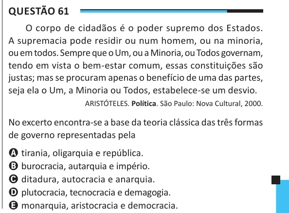

Texto extraído (pode conter ruído)

Questão 61  
O corpo de cidadãos é o poder supremo dos Estados.  
A supremacia pode residir ou num homem, ou na minoria,  
ou em todos. Sempre que o Um, ou a Minoria, ou Todos governam,  
tendo em vista o bem-estar comum, essas constituições são  
justas; mas se procuram apenas o benefício de uma das partes,  
seja ela o Um, a Minoria ou Todos, estabelece-se um desvio.  
ARISTÓTELES. Política. São Paulo: Nova Cultural, 2000.  
No excerto encontra-se a base da teoria clássica das três formas  
de governo representadas pela  
A tirania, oligarquia e república.  
B burocracia, autarquia e império.  
C ditadura, autocracia e anarquia.  
D plutocracia, tecnocracia e demagogia.  
E monarquia, aristocracia e democracia.

