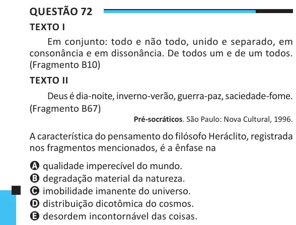

Texto extraído (pode conter ruído)

Questão 72  
TEXTO I  
Em conjunto: todo e não todo, unido e separado, em  
consonância e em dissonância. De todos um e de um todos.  
(Fragmento B10)  
TEXTO II  
Deus é dia-noite, inverno-verão, guerra-paz, saciedade-fome.  
(Fragmento B67)  
Pré-socráticos. São Paulo: Nova Cultural, 1996.  
A característica do pensamento do filósofo Heráclito, registrada  
nos fragmentos mencionados, é a ênfase na  
A qualidade imperecível do mundo.  
B degradação material da natureza.  
C imobilidade imanente do universo.  
D distribuição dicotômica do cosmos.  
E desordem incontornável das coisas.

