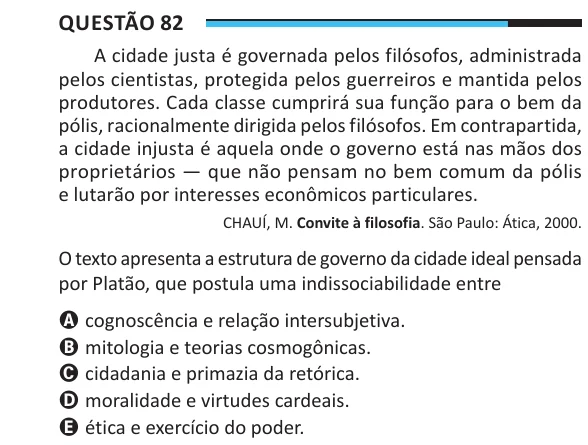

Texto extraído (pode conter ruído)

Questão 82  
A cidade justa é governada pelos filósofos, administrada  
pelos cientistas, protegida pelos guerreiros e mantida pelos  
produtores. Cada classe cumprirá sua função para o bem da  
pólis, racionalmente dirigida pelos filósofos. Em contrapartida,  
a cidade injusta é aquela onde o governo está nas mãos dos  
proprietários — que não pensam no bem comum da pólis  
e lutarão por interesses econômicos particulares.  
CHAUÍ, M. Convite à filosofia. São Paulo: Ática, 2000.  
O texto apresenta a estrutura de governo da cidade ideal pensada  
por Platão, que postula uma indissociabilidade entre  
A cognoscência e relação intersubjetiva.  
B mitologia e teorias cosmogônicas.  
C cidadania e primazia da retórica.  
D moralidade e virtudes cardeais.  
E ética e exercício do poder.

