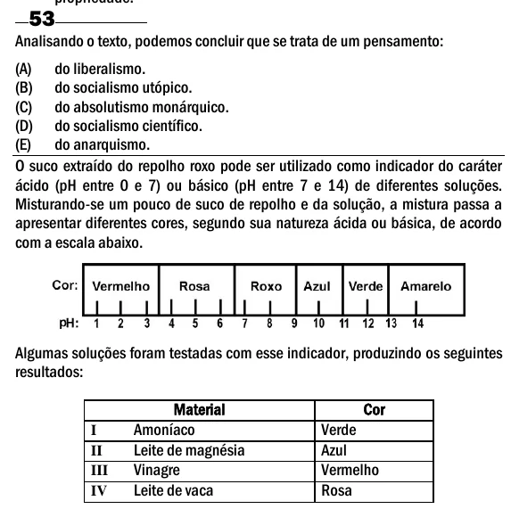

Texto extraído (pode conter ruído)

53  
Analisando o texto, podemos concluir que se trata de um pensamento:  
(A) do liberalismo.  
(B) do socialismo utópico.  
(C) do absolutismo monárquico.  
(D) do socialismo científico.  
(E) do anarquismo.  
O suco extraído do repolho roxo pode ser utilizado como indicador do caráter  
ácido (pH entre 0 e 7) ou básico (pH entre 7 e 14) de diferentes soluções.  
Misturando-se um pouco de suco de repolho e da solução, a mistura passa a  
apresentar diferentes cores, segundo sua natureza ácida ou básica, de acordo  
com a escala abaixo.  
Algumas soluções foram testadas com esse indicador, produzindo os seguintes  
resultados:  
Material  
Cor  
Amoníaco  
Verde  
I  
Leite de magnésia  
Azul  
II  
Vinagre  
Vermelho  
III  
Leite de vaca  
Rosa  
IV

