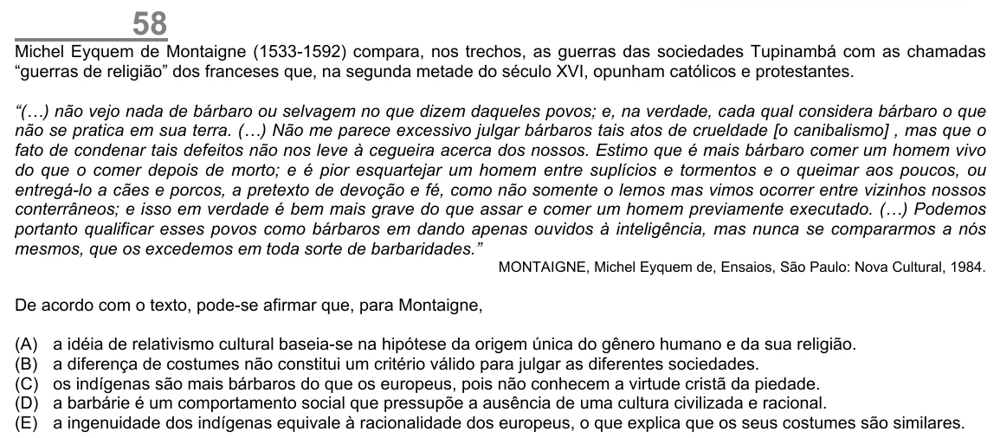

Texto extraído (pode conter ruído)

58  
Michel Eyquem de Montaigne (1533-1592) compara, nos trechos, as guerras das sociedades Tupinambá com as chamadas  
“guerras de religião” dos franceses que, na segunda metade do século XVI, opunham católicos e protestantes.  
“(…) não vejo nada de bárbaro ou selvagem no que dizem daqueles povos; e, na verdade, cada qual considera bárbaro o que  
não se pratica em sua terra. (…) Não me parece excessivo julgar bárbaros tais atos de crueldade [o canibalismo] , mas que o  
fato de condenar tais defeitos não nos leve à cegueira acerca dos nossos. Estimo que é mais bárbaro comer um homem vivo  
do que o comer depois de morto; e é pior esquartejar um homem entre suplícios e tormentos e o queimar aos poucos, ou  
entregá-lo a cães e porcos, a pretexto de devoção e fé, como não somente o lemos mas vimos ocorrer entre vizinhos nossos  
conterrâneos; e isso em verdade é bem mais grave do que assar e comer um homem previamente executado. (…) Podemos  
portanto qualificar esses povos como bárbaros em dando apenas ouvidos à inteligência, mas nunca se compararmos a nós  
mesmos, que os excedemos em toda sorte de barbaridades.”  
MONTAIGNE, Michel Eyquem de, Ensaios, São Paulo: Nova Cultural, 1984.  
De acordo com o texto, pode-se afirmar que, para Montaigne,  
(A)  
a idéia de relativismo cultural baseia-se na hipótese da origem única do gênero humano e da sua religião.  
(B)  
a diferença de costumes não constitui um critério válido para julgar as diferentes sociedades.  
(C)  
os indígenas são mais bárbaros do que os europeus, pois não conhecem a virtude cristã da piedade.  
(D)  
a barbárie é um comportamento social que pressupõe a ausência de uma cultura civilizada e racional.  
(E)  
a ingenuidade dos indígenas equivale à racionalidade dos europeus, o que explica que os seus costumes são similares.

