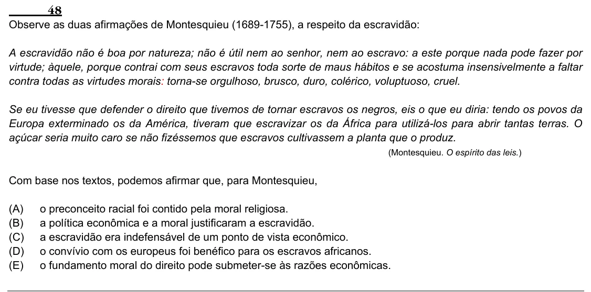

Texto extraído (pode conter ruído)

48  
Observe as duas afirmações de Montesquieu (1689-1755), a respeito da escravidão:  
A escravidão não é boa por natureza; não é útil nem ao senhor, nem ao escravo: a este porque nada pode fazer por  
virtude; àquele, porque contrai com seus escravos toda sorte de maus hábitos e se acostuma insensivelmente a faltar  
contra todas as virtudes morais: torna-se orgulhoso, brusco, duro, colérico, voluptuoso, cruel.  
Se eu tivesse que defender o direito que tivemos de tornar escravos os negros, eis o que eu diria: tendo os povos da  
Europa exterminado os da América, tiveram que escravizar os da África para utilizá-los para abrir tantas terras. O  
açúcar seria muito caro se não fizéssemos que escravos cultivassem a planta que o produz.  
(Montesquieu. O espírito das leis.)  
Com base nos textos, podemos afirmar que, para Montesquieu,  
(A)  
o preconceito racial foi contido pela moral religiosa.  
(B)  
a política econômica e a moral justificaram a escravidão.  
(C)  
a escravidão era indefensável de um ponto de vista econômico.  
(D)  
o convívio com os europeus foi benéfico para os escravos africanos.  
(E)  
o fundamento moral do direito pode submeter-se às razões econômicas.

