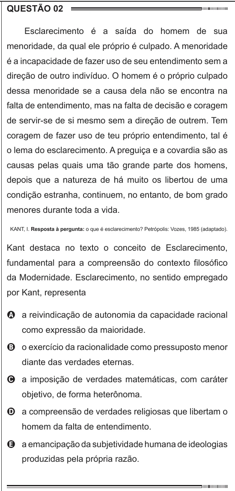

Texto extraído (pode conter ruído)

Esclarecimento é a saída do homem de sua  
menoridade, da qual ele próprio é culpado. A menoridade  
é a incapacidade de fazer uso de seu entendimento sem a  
direção de outro indivíduo. O homem é o próprio culpado  
dessa menoridade se a causa dela não se encontra na  
falta de entendimento, mas na falta de decisão e coragem  
de servir-se de si mesmo sem a direção de outrem. Tem  
coragem de fazer uso de teu próprio entendimento, tal é  
o lema do esclarecimento. A preguiça e a covardia são as  
causas pelas quais uma tão grande parte dos homens,  
depois que a natureza de há muito os libertou de uma  
condição estranha, continuem, no entanto, de bom grado  
menores durante toda a vida.  
KANT, I. Resposta à pergunta: o que é esclarecimento? Petrópolis: Vozes, 1985 (adaptado).  
Kant destaca no texto o conceito de Esclarecimento,  
fundamental para a compreensão do contexto filosófico  
da Modernidade. Esclarecimento, no sentido empregado  
por Kant, representa  
A a reivindicação de autonomia da capacidade racional  
como expressão da maioridade.  
B o exercício da racionalidade como pressuposto menor  
diante das verdades eternas.  
C a imposição de verdades matemáticas, com caráter  
objetivo, de forma heterônoma.  
D a compreensão de verdades religiosas que libertam o  
homem da falta de entendimento.  
E a emancipação da subjetividade humana de ideologias  
produzidas pela própria razão.

