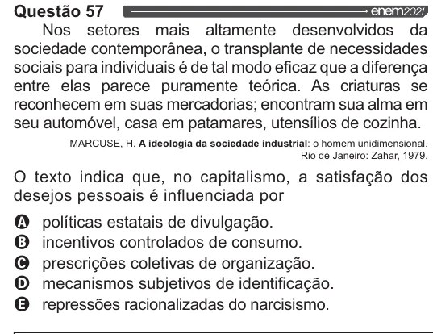

Texto extraído (pode conter ruído)

Questão 57  
Nos setores mais altamente desenvolvidos da  
sociedade contemporânea, o transplante de necessidades  
sociais para individuais é de tal modo eficaz que a diferença  
entre elas parece puramente teórica. As criaturas se  
reconhecem em suas mercadorias; encontram sua alma em  
seu automóvel, casa em patamares, utensílios de cozinha.  
MARCUSE, H. A ideologia da sociedade industrial: o homem unidimensional.  
Rio de Janeiro: Zahar, 1979.  
O texto indica que, no capitalismo, a satisfação dos  
desejos pessoais é influenciada por  
VOVOO  
políticas estatais de divulgação.  
incentivos controlados de consumo.  
prescrições coletivas de organização.  
mecanismos subjetivos de identificação.  
repressões racionalizadas do narcisismo.

