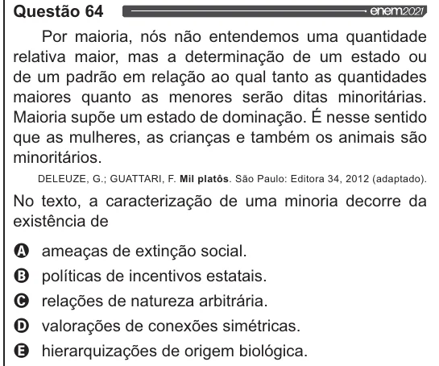

Texto extraído (pode conter ruído)

Questão 64  
Por maioria, nós não entendemos uma quantidade  
relativa maior, mas a determinação de um estado ou  
de um padrão em relação ao qual tanto as quantidades  
maiores quanto as menores serão ditas minoritárias.  
Maioria supõe um estado de dominação. É nesse sentido  
que as mulheres, as crianças e também os animais são  
minoritários.  
DELEUZE, G.; GUATTARI, F. Mil platôs. São Paulo: Editora 34, 2012 (adaptado).  
No texto, a caracterização de uma minoria decorre da  
existência de  
VOO  
ameaças de extinção social.  
políticas de incentivos estatais.  
relações de natureza arbitrária.  
valorações de conexões simétricas.  
hierarquizações de origem biológica.

