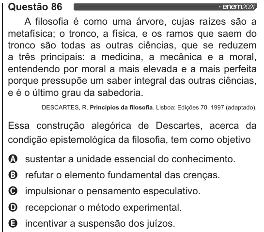

Texto extraído (pode conter ruído)

Questão 86  
A filosofia é como uma árvore, cujas raízes são a  
metafísica; o tronco, a física, e os ramos que saem do  
tronco são todas as outras ciências, que se reduzem  
a três principais: a medicina, a mecânica e a moral,  
entendendo por moral a mais elevada e a mais perfeita  
porque pressupõe um saber integral das outras ciências,  
e é o último grau da sabedoria.  
DESCARTES, R. Princípios da filosofia. Lisboa: Edições 70, 1997 (adaptado).  
Essa construção alegórica de Descartes, acerca da  
condição epistemológica da filosofia, tem como objetivo  
Q sustentar a unidade essencial do conhecimento.  
O refutar o elemento fundamental das crenças.  
O impulsionar o pensamento especulativo.  
O recepcionar o método experimental.  
& incentivar a suspensão dos juízos.

