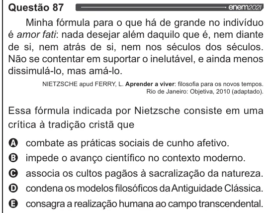

Texto extraído (pode conter ruído)

Questão 87  
Minha fórmula para o que há de grande no indivíduo  
é amor fati: nada desejar além daquilo que é, nem diante  
de si, nem atrás de si, nem nos séculos dos séculos.  
Não se contentar em suportar o inelutável, e ainda menos  
dissimulá-lo, mas amá-lo.  
NIETZSCHE apud FERRY, L. Aprender a viver: filosofia para os novos tempos.  
Rio de Janeiro: Objetiva, 2010 (adaptado).  
Essa fórmula indicada por Nietzsche consiste em uma  
crítica à tradição cristã que  
OQ combate as práticas sociais de cunho afetivo.  
O impede o avanço científico no contexto moderno.  
O associa os cultos pagãos à sacralização da natureza.  
O condena os modelos filosóficos da Antiguidade Clássica.  
& consagra a realização humana ao campo transcendental.

