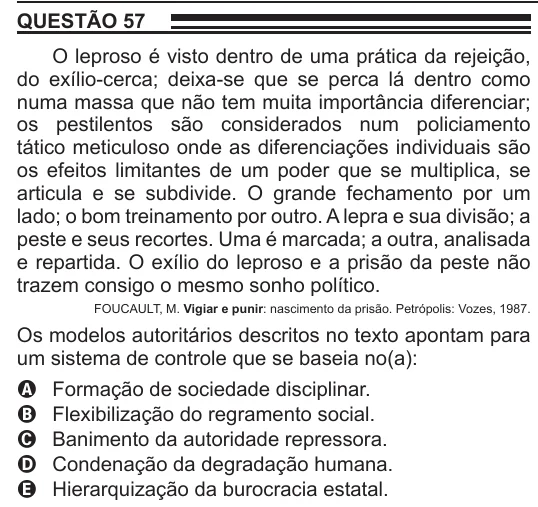

Texto extraído (pode conter ruído)

QUESTÃO 57  
O leproso é visto dentro de uma prática da rejeição,  
do exílio-cerca; deixa-se que se perca lá dentro como  
numa massa que não tem muita importância diferenciar;  
os pestilentos são considerados num policiamento  
tático meticuloso onde as diferenciações individuais são  
os efeitos limitantes de um poder que se multiplica, se  
articula e se subdivide. O grande fechamento por um  
lado; o bom treinamento por outro. A lepra e sua divisão; a  
peste e seus recortes. Uma é marcada; a outra, analisada  
e repartida. O exílio do leproso e a prisão da peste não  
trazem consigo o mesmo sonho político.  
FOUCAULT, M. Vigiar e punir: nascimento da prisão. Petrópolis: Vozes, 1987.  
Os modelos autoritários descritos no texto apontam para  
um sistema de controle que se baseia no(a):  
Formação de sociedade disciplinar.  
A  
B  
Flexibilização do regramento social.  
C  
Banimento da autoridade repressora.  
D  
Condenação da degradação humana.  
E  
Hierarquização da burocracia estatal.

