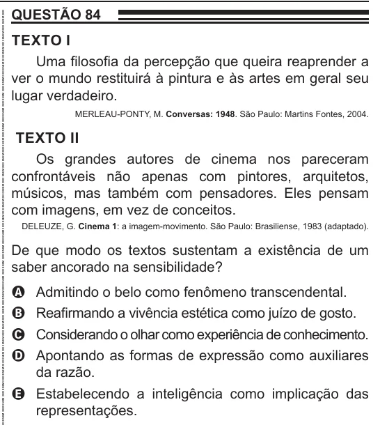

Texto extraído (pode conter ruído)

QUESTÃO 84  
TEXTO I  
Uma filosofia da percepção que queira reaprender a  
ver o mundo restituirá à pintura e às artes em geral seu  
lugar verdadeiro.  
MERLEAU-PONTY, M. Conversas: 1948. São Paulo: Martins Fontes, 2004.  
TEXTO II  
Os grandes autores de cinema nos pareceram  
confrontáveis não apenas com pintores, arquitetos,  
músicos, mas também com pensadores. Eles pensam  
com imagens, em vez de conceitos.  
DELEUZE, G. Cinema 1: a imagem-movimento. São Paulo: Brasiliense, 1983 (adaptado).  
De que modo os textos sustentam a existência de um  
saber ancorado na sensibilidade?  
Admitindo o belo como fenômeno transcendental.  
A  
Reafirmando a vivência estética como juízo de gosto.  
B  
Considerando o olhar como experiência de conhecimento.  
C  
Apontando as formas de expressão como auxiliares  
D  
da razão.  
E Estabelecendo a inteligência como implicação das  
representações.

