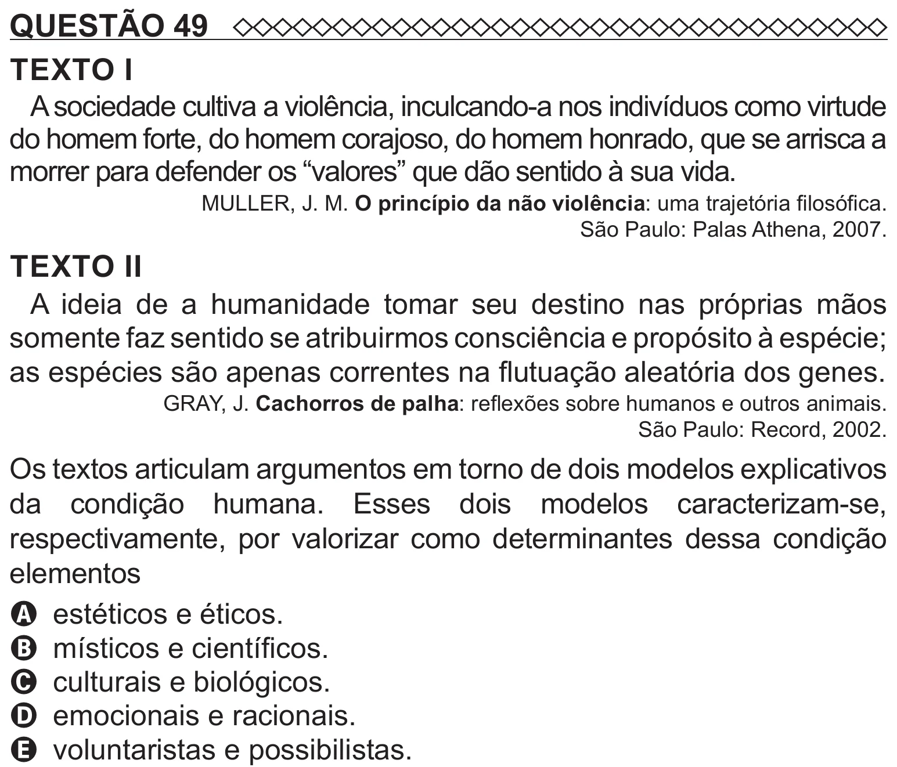

Texto extraído (pode conter ruído)

QUESTÃO 49  
TEXTO I  
A sociedade cultiva a violência, inculcando-a nos indivíduos como virtude  
do homem forte, do homem corajoso, do homem honrado, que se arrisca a  
morrer para defender os “valores” que dão sentido à sua vida.  
MULLER, J. M. O princípio da não violência: uma trajetória filosófica.  
São Paulo: Palas Athena, 2007.  
TEXTO II  
A ideia de a humanidade tomar seu destino nas próprias mãos  
somente faz sentido se atribuirmos consciência e propósito à espécie;  
as espécies são apenas correntes na flutuação aleatória dos genes.  
GRAY, J. Cachorros de palha: reflexões sobre humanos e outros animais.  
São Paulo: Record, 2002.  
Os textos articulam argumentos em torno de dois modelos explicativos  
da condição humana. Esses dois modelos caracterizam-se,  
respectivamente, por valorizar como determinantes dessa condição  
elementos  
A estéticos e éticos.  
B místicos e científicos.  
C culturais e biológicos.  
D emocionais e racionais.

