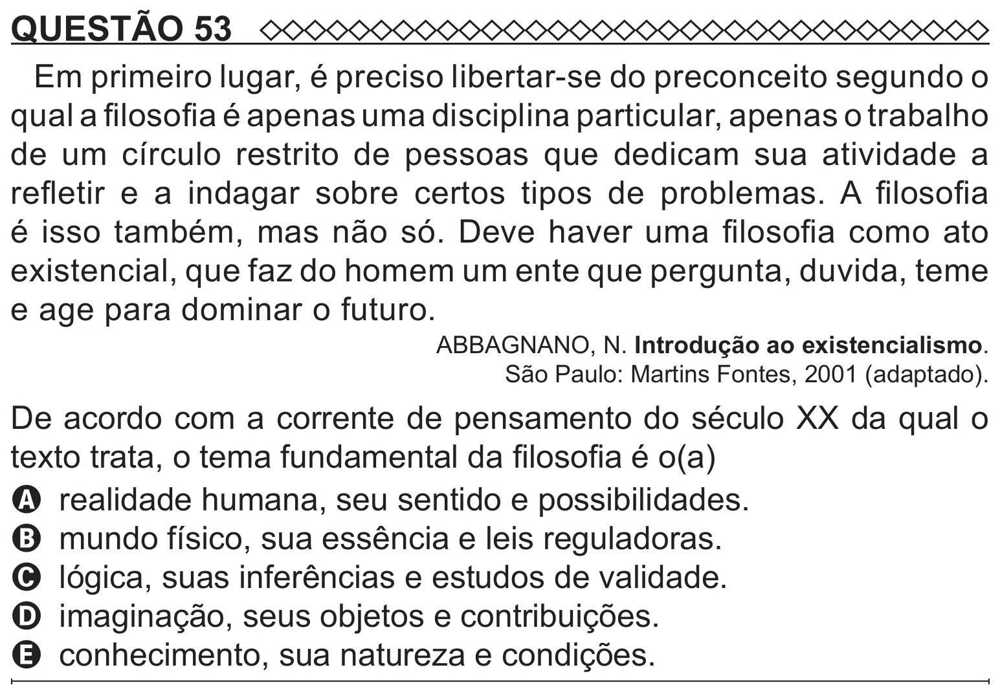

Texto extraído (pode conter ruído)

QUESTÃO 53  
Em primeiro lugar, é preciso libertar-se do preconceito segundo o  
qual a filosofia é apenas uma disciplina particular, apenas o trabalho  
de um círculo restrito de pessoas que dedicam sua atividade a  
refletir e a indagar sobre certos tipos de problemas. A filosofia  
é isso também, mas não só. Deve haver uma filosofia como ato  
existencial, que faz do homem um ente que pergunta, duvida, teme  
e age para dominar o futuro.  
ABBAGNANO, N. Introdução ao existencialismo.  
São Paulo: Martins Fontes, 2001 (adaptado).  
De acordo com a corrente de pensamento do século XX da qual o  
texto trata, o tema fundamental da filosofia é o(a)  
A realidade humana, seu sentido e possibilidades.  
B mundo físico, sua essência e leis reguladoras.  
C lógica, suas inferências e estudos de validade.  
D imaginação, seus objetos e contribuições.  
E conhecimento, sua natureza e condições.

