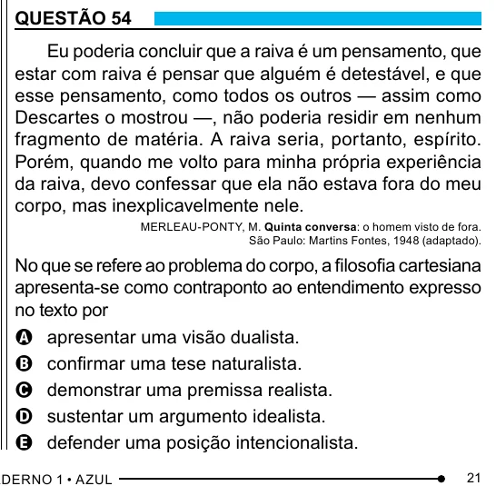

Texto extraído (pode conter ruído)

QUESTÃO 54  
Eu poderia concluir que a raiva é um pensamento, que  
estar com raiva é pensar que alguém é detestável, e que  
esse pensamento, como todos os outros — assim como  
Descartes o mostrou —, não poderia residir em nenhum  
fragmento de matéria. A raiva seria, portanto, espírito.  
Porém, quando me volto para minha própria experiência  
da raiva, devo confessar que ela não estava fora do meu  
corpo, mas inexplicavelmente nele.  
MERLEAU-PONTY, M. Quinta conversa: o homem visto de fora.  
São Paulo: Martins Fontes, 1948 (adaptado).  
No que se refere ao problema do corpo, a filosofia cartesiana  
apresenta-se como contraponto ao entendimento expresso  
no texto por  
A apresentar uma visão dualista.  
B confirmar uma tese naturalista.  
C demonstrar uma premissa realista.  
D sustentar um argumento idealista.  
E defender uma posição intencionalista.  
21

