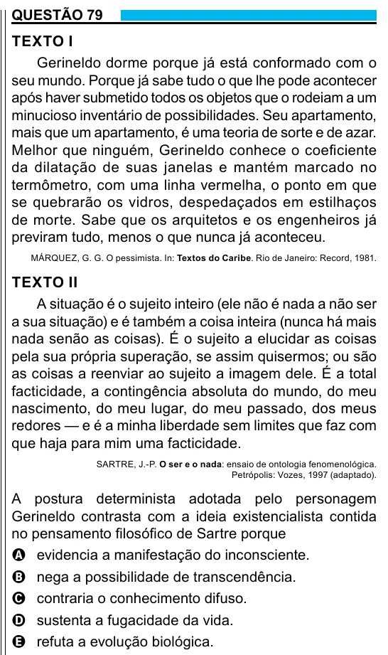

Texto extraído (pode conter ruído)

QUESTÃO 79  
TEXTO I  
Gerineldo dorme porque já está conformado com o  
seu mundo. Porque já sabe tudo o que lhe pode acontecer  
após haver submetido todos os objetos que o rodeiam a um  
minucioso inventário de possibilidades. Seu apartamento,  
mais que um apartamento, é uma teoria de sorte e de azar.  
Melhor que ninguém, Gerineldo conhece o coeficiente  
da dilatação de suas janelas e mantém marcado no  
termômetro, com uma linha vermelha, o ponto em que  
se quebrarão os vidros, despedaçados em estilhaços  
de morte. Sabe que os arquitetos e os engenheiros já  
previram tudo, menos o que nunca já aconteceu.  
MÁRQUEZ, G. G. O pessimista. In: Textos do Caribe. Rio de Janeiro: Record, 1981.  
TEXTO II  
A situação é o sujeito inteiro (ele não é nada a não ser  
a sua situação) e é também a coisa inteira (nunca há mais  
nada senão as coisas). É o sujeito a elucidar as coisas  
pela sua própria superação, se assim quisermos; ou são  
as coisas a reenviar ao sujeito a imagem dele. É a total  
facticidade, a contingência absoluta do mundo, do meu  
nascimento, do meu lugar, do meu passado, dos meus  
redores — e é a minha liberdade sem limites que faz com  
que haja para mim uma facticidade.  
SARTRE, J.-P. O ser e o nada: ensaio de ontologia fenomenológica.  
Petrópolis: Vozes, 1997 (adaptado).  
A postura determinista adotada pelo personagem  
Gerineldo contrasta com a ideia existencialista contida  
no pensamento filosófico de Sartre porque  
A evidencia a manifestação do inconsciente.  
B nega a possibilidade de transcendência.  
C contraria o conhecimento difuso.  
D sustenta a fugacidade da vida.  
E refuta a evolução biológica.

