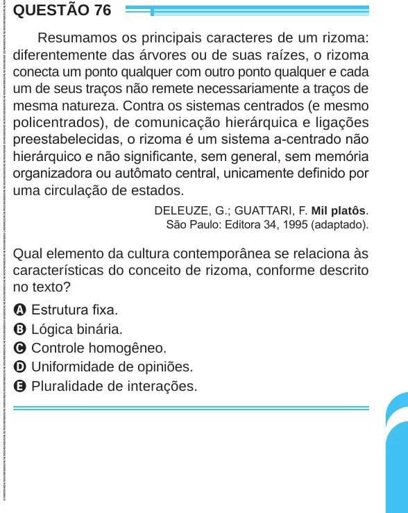

Texto extraído (pode conter ruído)

QUESTÃO 76  
Resumamos os principais caracteres de um rizoma:  
diferentemente das árvores ou de suas raízes, o rizoma  
conecta um ponto qualquer com outro ponto qualquer e cada  
um de seus traços não remete necessariamente a traços de  
mesma natureza. Contra os sistemas centrados (e mesmo  
policentrados), de comunicação hierárquica e ligações  
preestabelecidas, o rizoma é um sistema a-centrado não  
hierárquico e não significante, sem general, sem memória  
organizadora ou autômato central, unicamente definido por  
uma circulação de estados.  
DELEUZE, G.; GUATTARI, F. Mil platôs.  
São Paulo: Editora 34, 1995 (adaptado).  
Qual elemento da cultura contemporânea se relaciona às  
características do conceito de rizoma, conforme descrito  
no texto?  
A Estrutura fixa.  
B Lógica binária.  
C Controle homogêneo.  
D Uniformidade de opiniões.  
E Pluralidade de interações.

