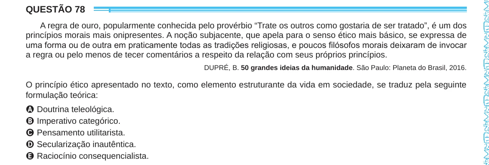

Texto extraído (pode conter ruído)

QUESTÃO 78  
A regra de ouro, popularmente conhecida pelo provérbio “Trate os outros como gostaria de ser tratado”, é um dos  
princípios morais mais onipresentes. A noção subjacente, que apela para o senso ético mais básico, se expressa de  
uma forma ou de outra em praticamente todas as tradições religiosas, e poucos filósofos morais deixaram de invocar  
a regra ou pelo menos de tecer comentários a respeito da relação com seus próprios princípios.  
DUPRÉ, B. 50 grandes ideias da humanidade. São Paulo: Planeta do Brasil, 2016.  
O princípio ético apresentado no texto, como elemento estruturante da vida em sociedade, se traduz pela seguinte  
formulação teórica:  
A Doutrina teleológica.  
B Imperativo categórico.  
C Pensamento utilitarista.  
D Secularização inautêntica.  
E Raciocínio consequencialista.

