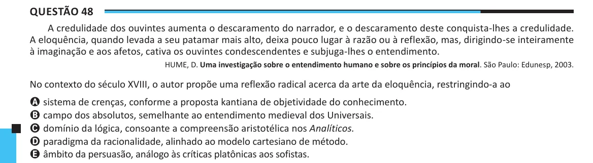

Texto extraído (pode conter ruído)

Questão 48  
A credulidade dos ouvintes aumenta o descaramento do narrador, e o descaramento deste conquista-lhes a credulidade.  
A eloquência, quando levada a seu patamar mais alto, deixa pouco lugar à razão ou à reflexão, mas, dirigindo-se inteiramente  
à imaginação e aos afetos, cativa os ouvintes condescendentes e subjuga-lhes o entendimento.  
HUME, D. Uma investigação sobre o entendimento humano e sobre os princípios da moral. São Paulo: Edunesp, 2003.  
No contexto do século XVIII, o autor propõe uma reflexão radical acerca da arte da eloquência, restringindo-a ao  
A sistema de crenças, conforme a proposta kantiana de objetividade do conhecimento.  
B campo dos absolutos, semelhante ao entendimento medieval dos Universais.  
C domínio da lógica, consoante a compreensão aristotélica nos Analíticos.  
D paradigma da racionalidade, alinhado ao modelo cartesiano de método.  
E âmbito da persuasão, análogo às críticas platônicas aos sofistas.

