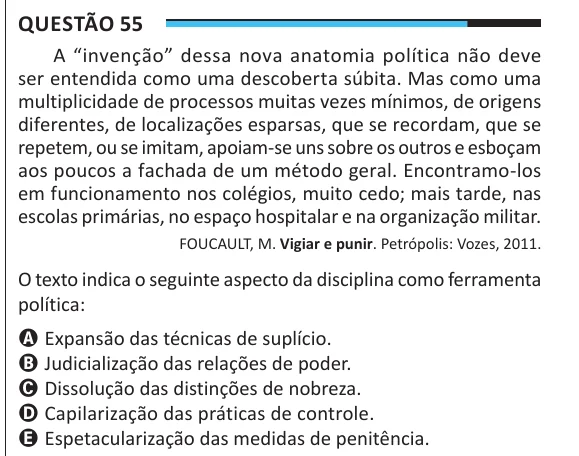

Texto extraído (pode conter ruído)

Questão 55  
A “invenção” dessa nova anatomia política não deve  
ser entendida como uma descoberta súbita. Mas como uma  
multiplicidade de processos muitas vezes mínimos, de origens  
diferentes, de localizações esparsas, que se recordam, que se  
repetem, ou se imitam, apoiam-se uns sobre os outros e esboçam  
aos poucos a fachada de um método geral. Encontramo-los  
em funcionamento nos colégios, muito cedo; mais tarde, nas  
escolas primárias, no espaço hospitalar e na organização militar.  
FOUCAULT, M. Vigiar e punir. Petrópolis: Vozes, 2011.  
O texto indica o seguinte aspecto da disciplina como ferramenta  
política:  
A Expansão das técnicas de suplício.  
B Judicialização das relações de poder.  
C Dissolução das distinções de nobreza.  
D Capilarização das práticas de controle.  
E Espetacularização das medidas de penitência.

