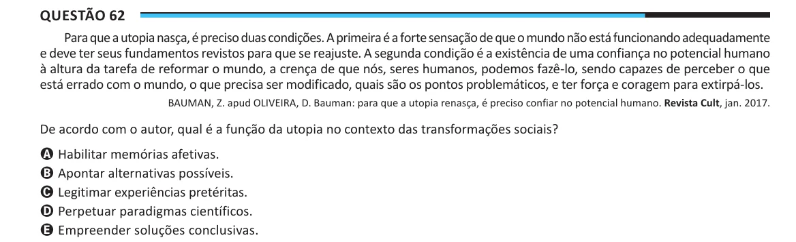

Texto extraído (pode conter ruído)

Questão 62  
Para que a utopia nasça, é preciso duas condições. A primeira é a forte sensação de que o mundo não está funcionando adequadamente  
e deve ter seus fundamentos revistos para que se reajuste. A segunda condição é a existência de uma confiança no potencial humano  
à altura da tarefa de reformar o mundo, a crença de que nós, seres humanos, podemos fazê-lo, sendo capazes de perceber o que  
está errado com o mundo, o que precisa ser modificado, quais são os pontos problemáticos, e ter força e coragem para extirpá-los.  
BAUMAN, Z. apud OLIVEIRA, D. Bauman: para que a utopia renasça, é preciso confiar no potencial humano. Revista Cult, jan. 2017.  
De acordo com o autor, qual é a função da utopia no contexto das transformações sociais?  
A Habilitar memórias afetivas.  
B Apontar alternativas possíveis.  
C Legitimar experiências pretéritas.  
D Perpetuar paradigmas científicos.  
E Empreender soluções conclusivas.

