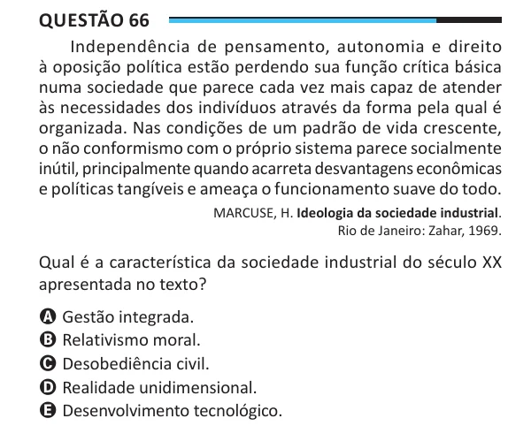

Texto extraído (pode conter ruído)

Questão 66  
Independência de pensamento, autonomia e direito  
à oposição política estão perdendo sua função crítica básica  
numa sociedade que parece cada vez mais capaz de atender  
às necessidades dos indivíduos através da forma pela qual é  
organizada. Nas condições de um padrão de vida crescente,  
o não conformismo com o próprio sistema parece socialmente  
inútil, principalmente quando acarreta desvantagens econômicas  
e políticas tangíveis e ameaça o funcionamento suave do todo.  
MARCUSE, H. Ideologia da sociedade industrial.  
Rio de Janeiro: Zahar, 1969.  
Qual é a característica da sociedade industrial do século XX  
apresentada no texto?  
A Gestão integrada.  
B Relativismo moral.  
C Desobediência civil.  
D Realidade unidimensional.  
E Desenvolvimento tecnológico.

