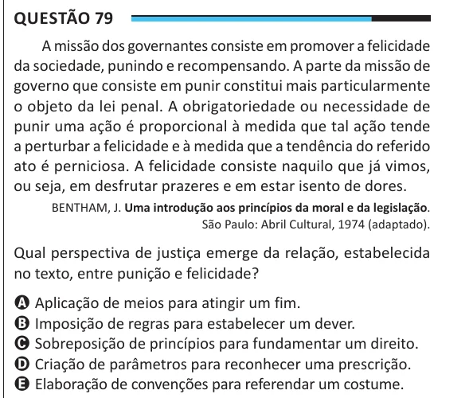

Texto extraído (pode conter ruído)

Questão 79  
A missão dos governantes consiste em promover a felicidade  
da sociedade, punindo e recompensando. A parte da missão de  
governo que consiste em punir constitui mais particularmente  
o objeto da lei penal. A obrigatoriedade ou necessidade de  
punir uma ação é proporcional à medida que tal ação tende  
a perturbar a felicidade e à medida que a tendência do referido  
ato é perniciosa. A felicidade consiste naquilo que já vimos,  
ou seja, em desfrutar prazeres e em estar isento de dores.  
BENTHAM, J. Uma introdução aos princípios da moral e da legislação.  
São Paulo: Abril Cultural, 1974 (adaptado).  
Qual perspectiva de justiça emerge da relação, estabelecida  
no texto, entre punição e felicidade?  
A Aplicação de meios para atingir um fim.  
B Imposição de regras para estabelecer um dever.  
C Sobreposição de princípios para fundamentar um direito.  
D Criação de parâmetros para reconhecer uma prescrição.  
E Elaboração de convenções para referendar um costume.

