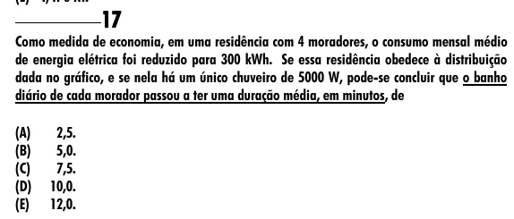

Texto extraído (pode conter ruído)

17  
Como medida de economia, em uma residência com 4 moradores, o consumo mensal médio  
de energia elétrica foi reduzido para 300 kWh. Se essa residência obedece à distribuição  
dada no gráfico, e se nela há um único chuveiro de 5000 W, pode-se concluir que o banho  
diário de cada morador passou a ter uma duração média, em minutos, de  
(A)  
2,5.  
(B)  
5,0.  
(C)  
7,5.  
(D)  
10,0.  
(E)  
12,0.

