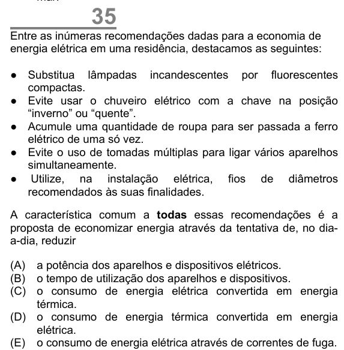

Texto extraído (pode conter ruído)

35  
Entre as inúmeras recomendações dadas para a economia de  
energia elétrica em uma residência, destacamos as seguintes:  
● Substitua lâmpadas incandescentes por fluorescentes  
compactas.  
● Evite usar o chuveiro elétrico com a chave na posição  
“inverno” ou “quente”.  
● Acumule uma quantidade de roupa para ser passada a ferro  
elétrico de uma só vez.  
● Evite o uso de tomadas múltiplas para ligar vários aparelhos  
simultaneamente.  
● Utilize, na instalação elétrica, fios de diâmetros  
recomendados às suas finalidades.  
A característica comum a todas essas recomendações é a  
proposta de economizar energia através da tentativa de, no dia-  
a-dia, reduzir  
(A) a potência dos aparelhos e dispositivos elétricos.  
(B) o tempo de utilização dos aparelhos e dispositivos.  
(C) o consumo de energia elétrica convertida em energia  
térmica.  
(D) o consumo de energia térmica convertida em energia  
elétrica.  
(E) o consumo de energia elétrica através de correntes de fuga.

