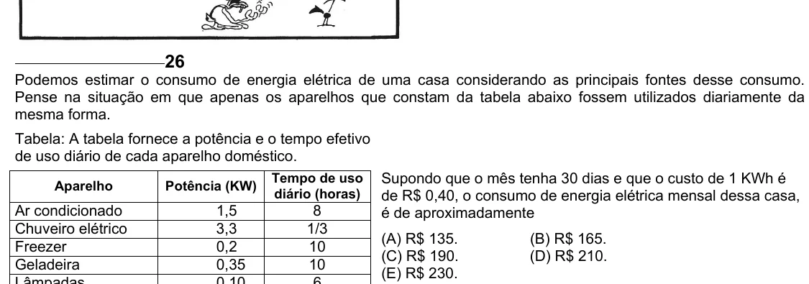

Texto extraído (pode conter ruído)

26  
Podemos estimar o consumo de energia elétrica de uma casa considerando as principais fontes desse consumo.  
Pense na situação em que apenas os aparelhos que constam da tabela abaixo fossem utilizados diariamente da  
mesma forma.  
Tabela: A tabela fornece a potência e o tempo efetivo  
de uso diário de cada aparelho doméstico.  
Tempo de uso  
Supondo que o mês tenha 30 dias e que o custo de 1 KWh é  
Aparelho  
Potência (KW)  
diário (horas)  
de R$ 0,40, o consumo de energia elétrica mensal dessa casa,  
Ar condicionado  
1,5  
8  
é de aproximadamente  
Chuveiro elétrico  
3,3  
1/3  
(A) R$ 135.  
(B) R$ 165.  
Freezer  
0,2  
10  
(C) R$ 190.  
(D) R$ 210.  
Geladeira  
0,35  
10  
(E) R$ 230.

