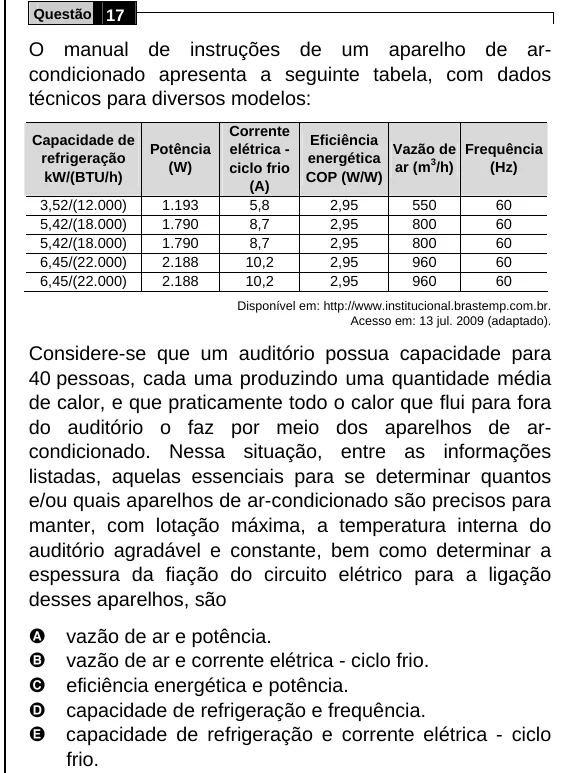

Texto extraído (pode conter ruído)

Questão 17  
O manual de instruções de um aparelho de ar-  
condicionado apresenta a seguinte tabela, com dados  
técnicos para diversos modelos:  
Corrente  
Capacidade de  
Eficiência  
Potência  
elétrica -  
Vazão de Frequência  
refrigeração  
energética  
(W)  
ciclo frio  
ar (m /h)  
3  
(Hz)  
kW/(BTU/h)  
COP (W/W)  
(A)  
3,52/(12.000)  
1.193  
5,8  
2,95  
550  
60  
5,42/(18.000)  
1.790  
8,7  
2,95  
800  
60  
5,42/(18.000)  
1.790  
8,7  
2,95  
800  
60  
6,45/(22.000)  
2.188  
10,2  
2,95  
960  
60  
6,45/(22.000)  
2.188  
10,2  
2,95  
960  
60  
Disponível em: http://www.institucional.brastemp.com.br.  
Acesso em: 13 jul. 2009 (adaptado).  
Considere-se que um auditório possua capacidade para  
40 pessoas, cada uma produzindo uma quantidade média  
de calor, e que praticamente todo o calor que flui para fora  
do auditório o faz por meio dos aparelhos de ar-  
condicionado. Nessa situação, entre as informações  
listadas, aquelas essenciais para se determinar quantos  
e/ou quais aparelhos de ar-condicionado são precisos para  
manter, com lotação máxima, a temperatura interna do  
auditório agradável e constante, bem como determinar a  
espessura da fiação do circuito elétrico para a ligação  
desses aparelhos, são  
A  
vazão de ar e potência.  
B  
vazão de ar e corrente elétrica - ciclo frio.  
C  
eficiência energética e potência.  
D  
capacidade de refrigeração e frequência.  
E  
capacidade de refrigeração e corrente elétrica - ciclo  
frio.

