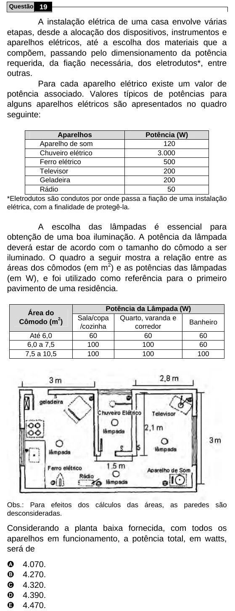

Texto extraído (pode conter ruído)

Questão 19  
A instalação elétrica de uma casa envolve várias  
etapas, desde a alocação dos dispositivos, instrumentos e  
aparelhos elétricos, até a escolha dos materiais que a  
compõem, passando pelo dimensionamento da potência  
requerida, da fiação necessária, dos eletrodutos*, entre  
outras.  
Para cada aparelho elétrico existe um valor de  
potência associado. Valores típicos de potências para  
alguns aparelhos elétricos são apresentados no quadro  
seguinte:  
Aparelhos  
Potência (W)  
Aparelho de som  
120  
Chuveiro elétrico  
3.000  
Ferro elétrico  
500  
Televisor  
200  
Geladeira  
200  
Rádio  
50  
*Eletrodutos são condutos por onde passa a fiação de uma instalação  
elétrica, com a finalidade de protegê-la.  
A escolha das lâmpadas é essencial para  
obtenção de uma boa iluminação. A potência da lâmpada  
deverá estar de acordo com o tamanho do cômodo a ser  
iluminado. O quadro a seguir mostra a relação entre as  
áreas dos cômodos (em m 2 ) e as potências das lâmpadas  
(em W), e foi utilizado como referência para o primeiro  
pavimento de uma residência.  
Potência da Lâmpada (W)  
Área do  
Sala/copa  
Quarto, varanda e  
Cômodo (m 2 )  
Banheiro  
/cozinha  
corredor  
Até 6,0  
60  
60  
60  
6,0 a 7,5  
100  
100  
60  
7,5 a 10,5  
100  
100  
100  
Obs.: Para efeitos dos cálculos das áreas, as paredes são  
desconsideradas.  
Considerando a planta baixa fornecida, com todos os  
aparelhos em funcionamento, a potência total, em watts,  
será de  
A  
4.070.  
B  
4.270.  
C  
4.320.  
D  
4.390.  
E  
4.470.

