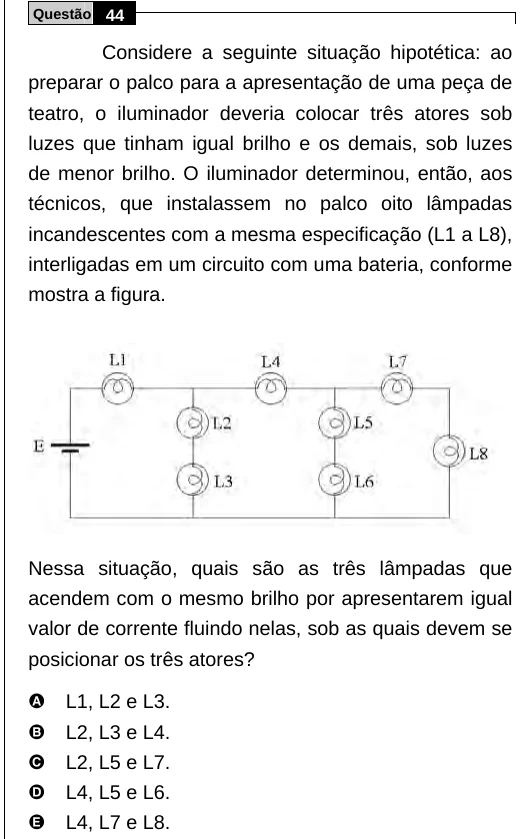

Texto extraído (pode conter ruído)

Questão 44  
Considere a seguinte situação hipotética: ao  
preparar o palco para a apresentação de uma peça de  
teatro, o iluminador deveria colocar três atores sob  
luzes que tinham igual brilho e os demais, sob luzes  
de menor brilho. O iluminador determinou, então, aos  
técnicos, que instalassem no palco oito lâmpadas  
incandescentes com a mesma especificação (L1 a L8),  
interligadas em um circuito com uma bateria, conforme  
mostra a figura.  
Nessa situação, quais são as três lâmpadas que  
acendem com o mesmo brilho por apresentarem igual  
valor de corrente fluindo nelas, sob as quais devem se  
posicionar os três atores?  
A  
L1, L2 e L3.  
B  
L2, L3 e L4.  
C  
L2, L5 e L7.  
D  
L4, L5 e L6.  
E  
L4, L7 e L8.

