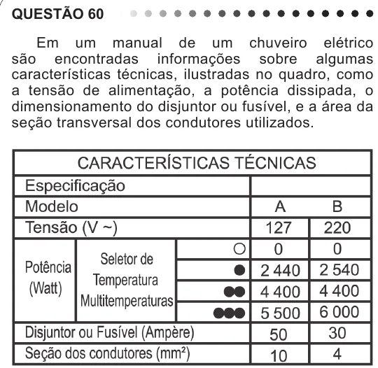

Texto extraído (pode conter ruído)

QUESTÃO 60  
Em um manual de um chuveiro elétrico  
são encontradas informações sobre algumas  
características técnicas, ilustradas no quadro, como  
a tensão de alimentação, a potência dissipada, o  
dimensionamento do disjuntor ou fusível, e a área da  
seção transversal dos condutores utilizados.  
Uma pessoa adquiriu um chuveiro do modelo A e,  
ao ler o manual, verificou que precisava ligá-lo a um  
disjuntor de 50 amperes. No entanto, intrigou-se com o  
fato de que o disjuntor a ser utilizado para uma correta  
instalação de um chuveiro do modelo B devia possuir  
amperagem 40% menor.  
Considerando-se os chuveiros de modelos A e B,  
funcionando à mesma potência de 4 400 W, a razão  
entre as suas respectivas resistências elétricas, R A e  
R B , que justifica a diferença de dimensionamento dos  
disjuntores, é mais próxima de:  
A  
0,3.  
0,6.  
B  
0,8.  
C  
D  
1,7.  
3,0.  
E

