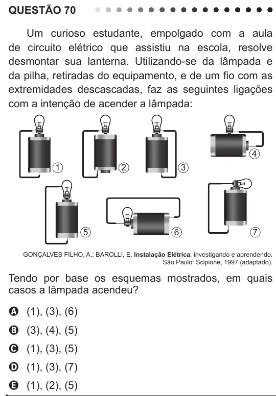

Texto extraído (pode conter ruído)

QUESTÃO 70  
Um curioso estudante, empolgado com a aula  
de circuito elétrico que assistiu na escola, resolve  
desmontar sua lanterna. Utilizando-se da lâmpada e  
da pilha, retiradas do equipamento, e de um fio com as  
extremidades descascadas, faz as seguintes ligações  
com a intenção de acender a lâmpada:  
4  
1  
2  
3  
5  
6  
7  
GONÇALVES FILHO, A.; BAROLLI, E. Instalação Elétrica: investigando e aprendendo.  
São Paulo: Scipione, 1997 (adaptado).  
Tendo por base os esquemas mostrados, em quais  
casos a lâmpada acendeu?  
A (1), (3), (6)  
B (3), (4), (5)  
C (1), (3), (5)  
D (1), (3), (7)  
E (1), (2), (5)

