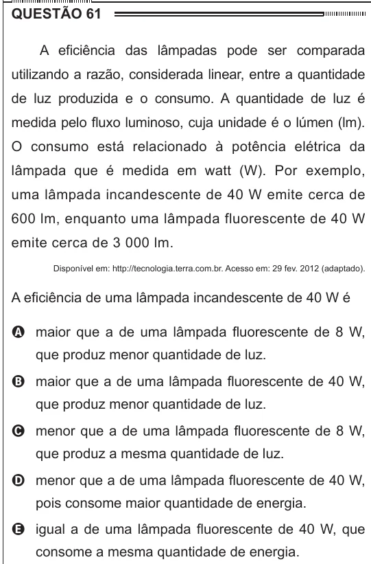

Texto extraído (pode conter ruído)

QUESTÃO 61  
A eficiência das lâmpadas pode ser comparada  
utilizando a razão, considerada linear, entre a quantidade  
de luz produzida e o consumo. A quantidade de luz é  
medida pelo fluxo luminoso, cuja unidade é o lúmen (lm).  
O consumo está relacionado à potência elétrica da  
lâmpada que é medida em watt (W). Por exemplo,  
uma lâmpada incandescente de 40 W emite cerca de  
600 lm, enquanto uma lâmpada fluorescente de 40 W  
emite cerca de 3 000 lm.  
Disponível em: http://tecnologia.terra.com.br. Acesso em: 29 fev. 2012 (adaptado).  
A eficiência de uma lâmpada incandescente de 40 W é  
A maior que a de uma lâmpada fluorescente de 8 W,  
que produz menor quantidade de luz.  
B maior que a de uma lâmpada fluorescente de 40 W,  
que produz menor quantidade de luz.  
C menor que a de uma lâmpada fluorescente de 8 W,  
que produz a mesma quantidade de luz.  
D menor que a de uma lâmpada fluorescente de 40 W,  
pois consome maior quantidade de energia.  
E igual a de uma lâmpada fluorescente de 40 W, que  
consome a mesma quantidade de energia.

