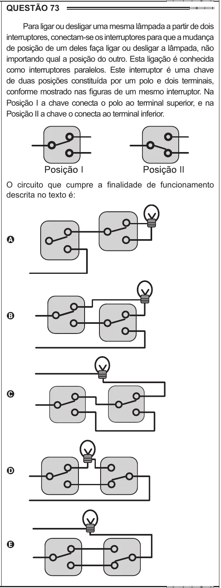

Texto extraído (pode conter ruído)

QUESTÃO 73  
Para ligar ou desligar uma mesma lâmpada a partir de dois  
interruptores, conectam-se os interruptores para que a mudança  
de posição de um deles faça ligar ou desligar a lâmpada, não  
importando qual a posição do outro. Esta ligação é conhecida  
como interruptores paralelos. Este interruptor é uma chave  
de duas posições constituída por um polo e dois terminais,  
conforme mostrado nas figuras de um mesmo interruptor. Na  
Posição I a chave conecta o polo ao terminal superior, e na  
Posição II a chave o conecta ao terminal inferior.  
O circuito que cumpre a finalidade de funcionamento  
descrita no texto é:  
A  
B  
C  
D  
E

