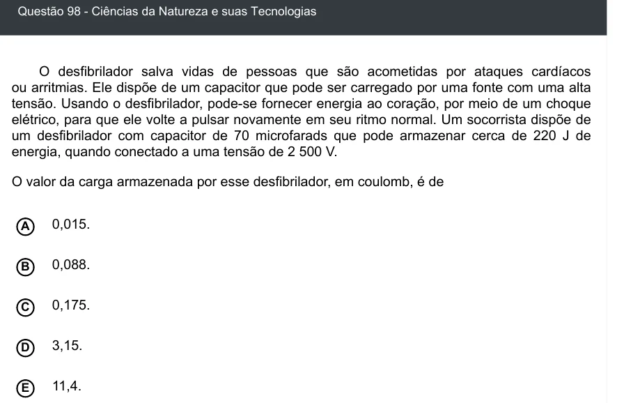

Texto extraído (pode conter ruído)

Questão 98 - Ciências da Natureza e suas Tecnologias  
O desfibrilador salva vidas de pessoas que são acometidas por ataques cardíacos  
ou arritmias. Ele dispõe de um capacitor que pode ser carregado por uma fonte com uma alta  
tensão. Usando o desfibrilador, pode-se fornecer energia ao coração, por meio de um choque  
elétrico, para que ele volte a pulsar novamente em seu ritmo normal. Um socorrista dispõe de  
um desfibrilador com capacitor de 70 microfarads que pode armazenar cerca de 220 J de  
energia, quando conectado a uma tensão de 2 500 V.  
O valor da carga armazenada por esse desfibrilador, em coulomb, é de  
A  
0,015.  
0,088.  
B  
0,175.  
C  
D  
3,15.  
11,4.  
E

