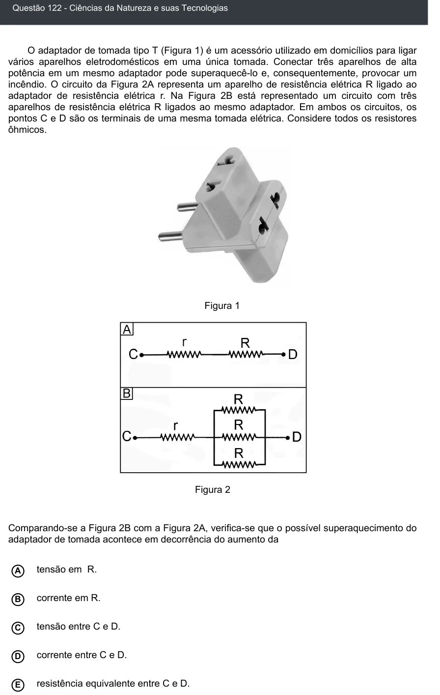

Texto extraído (pode conter ruído)

Questão 122 - Ciências da Natureza e suas Tecnologias  
O adaptador de tomada tipo T (Figura 1) é um acessório utilizado em domicílios para ligar  
vários aparelhos eletrodomésticos em uma única tomada. Conectar três aparelhos de alta  
potência em um mesmo adaptador pode superaquecê-lo e, consequentemente, provocar um  
incêndio. O circuito da Figura 2A representa um aparelho de resistência elétrica R ligado ao  
adaptador de resistência elétrica r. Na Figura 2B está representado um circuito com três  
aparelhos de resistência elétrica R ligados ao mesmo adaptador. Em ambos os circuitos, os  
pontos C e D são os terminais de uma mesma tomada elétrica. Considere todos os resistores  
ôhmicos.  
Figura 1  
Figura 2  
Comparando-se a Figura 2B com a Figura 2A, verifica-se que o possível superaquecimento do  
adaptador de tomada acontece em decorrência do aumento da  
A  
tensão em R.  
corrente em R.  
B  
tensão entre C e D.  
C  
corrente entre C e D.  
D  
E  
resistência equivalente entre C e D.

