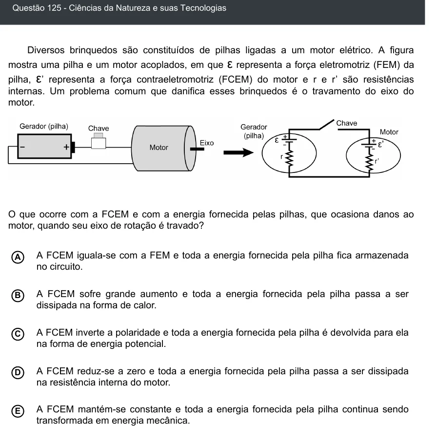

Texto extraído (pode conter ruído)

Questão 125 - Ciências da Natureza e suas Tecnologias  
Diversos brinquedos são constituídos de pilhas ligadas a um motor elétrico. A figura  
mostra uma pilha e um motor acoplados, em que ε representa a força eletromotriz (FEM) da  
pilha, ε ’ representa a força contraeletromotriz (FCEM) do motor e r e r’ são resistências  
internas. Um problema comum que danifica esses brinquedos é o travamento do eixo do  
motor.  
O que ocorre com a FCEM e com a energia fornecida pelas pilhas, que ocasiona danos ao  
motor, quando seu eixo de rotação é travado?  
A FCEM iguala-se com a FEM e toda a energia fornecida pela pilha fica armazenada  
A  
no circuito.  
B  
A FCEM sofre grande aumento e toda a energia fornecida pela pilha passa a ser  
dissipada na forma de calor.  
A FCEM inverte a polaridade e toda a energia fornecida pela pilha é devolvida para ela  
C  
na forma de energia potencial.  
A FCEM reduz-se a zero e toda a energia fornecida pela pilha passa a ser dissipada  
D  
na resistência interna do motor.  
A FCEM mantém-se constante e toda a energia fornecida pela pilha continua sendo  
E  
transformada em energia mecânica.

