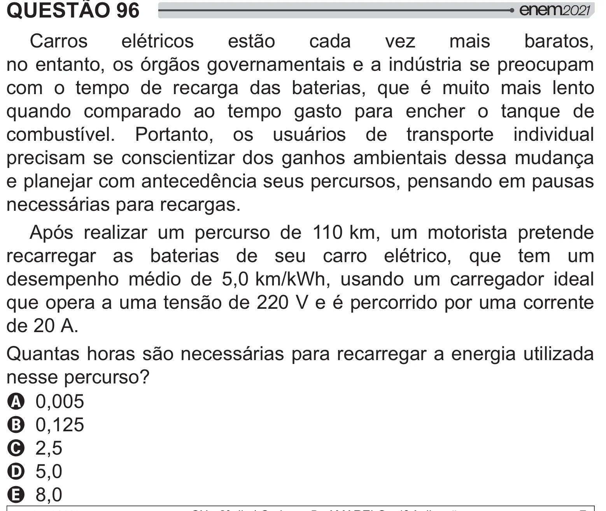

Texto extraído (pode conter ruído)

QUESTÃO 96  
Carros  
elétricos  
estão  
cada  
vez  
mais  
baratos,  
no entanto, os órgãos governamentais e a indústria se preocupam  
com o tempo de recarga das baterias, que é muito mais lento  
quando comparado ao tempo gasto para encher o tanque de  
combustível. Portanto, os usuários de transporte individual  
precisam se conscientizar dos ganhos ambientais dessa mudança  
e planejar com antecedência seus percursos, pensando em pausas  
necessárias para recargas.  
Após realizar um percurso de 110 km, um motorista pretende  
recarregar as baterias de seu carro elétrico, que tem um  
  
# $ <   _‚B‚X$        
que opera a uma tensão de 220 V e é percorrido por uma corrente  
de 20 A.  
Quantas horas são necessárias para recarregar a energia utilizada  
  
#   ]  
A 0,005  
B 0,125  
C 2,5  
D 5,0  
E 8,0

