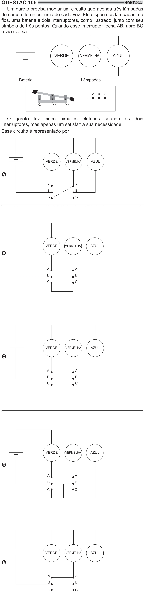

Texto extraído (pode conter ruído)

QUESTÃO 105  
Um garoto precisa montar um circuito que acenda três lâmpadas  
de cores diferentes, uma de cada vez. Ele dispõe das lâmpadas, de  
  y     #   ‡    
  
símbolo de três pontos. Quando esse interruptor fecha AB, abre BC  
e vice-versa.  
VERDE  
VERMELHA  
AZUL  
Bateria  
Lâmpadas  
A  
B  
C  
A  
B  
C  
O garoto fez cinco circuitos elétricos usando os  
dois  
interruptores, mas apenas um satisfaz a sua necessidade.  
Esse circuito é representado por  
VERDE  
VERMELHA  
AZUL  
A  
A  
A  
B  
B  
C  
C  
VERDE  
VERMELHA  
AZUL  
B  
A  
A  
B  
B  
C  
C  
VERDE  
VERMELHA  
AZUL  
C  
A  
A  
B  
B  
C  
C  
VERDE  
VERMELHA  
AZUL  
D  
A  
A  
B  
B  
C  
C  
VERDE  
VERMELHA  
AZUL  
E  
A  
A  
B  
B  
C  
C

