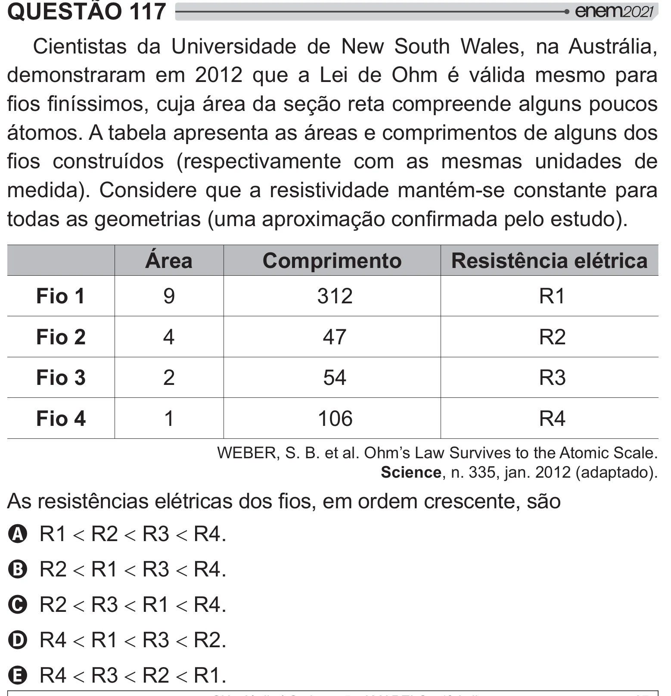

Texto extraído (pode conter ruído)

QUESTÃO 117  
      '"      ˆ Œ  $ X    /  
demonstraram em 2012 que a Lei de Ohm é válida mesmo para  
 {   ‡/  =[ #    #    
átomos. A tabela apresenta as áreas e comprimentos de alguns dos  
    {  J #  "              
medida). Considere que a resistividade mantém-se constante para  
     J #*=[#   
W!  
Área  
Comprimento  
Resistência elétrica  
Fio 1  
9  
312  
R1  
Fio 2  
4  
47  
R2  
Fio 3  
2  
54  
R3  
Fio 4  
1  
106  
R4  
Xš!š! !$¬ ?Œ ""   $   !  
Science, n. 335, jan. 2012 (adaptado).  
   
 +  <        
   [  
A R1  R2  R3  R4.  
B R2  R1  R3  R4.  
C R2  R3  R1  R4.  
D R4  R1  R3  R2.  
E R4  R3  R2  R1.

