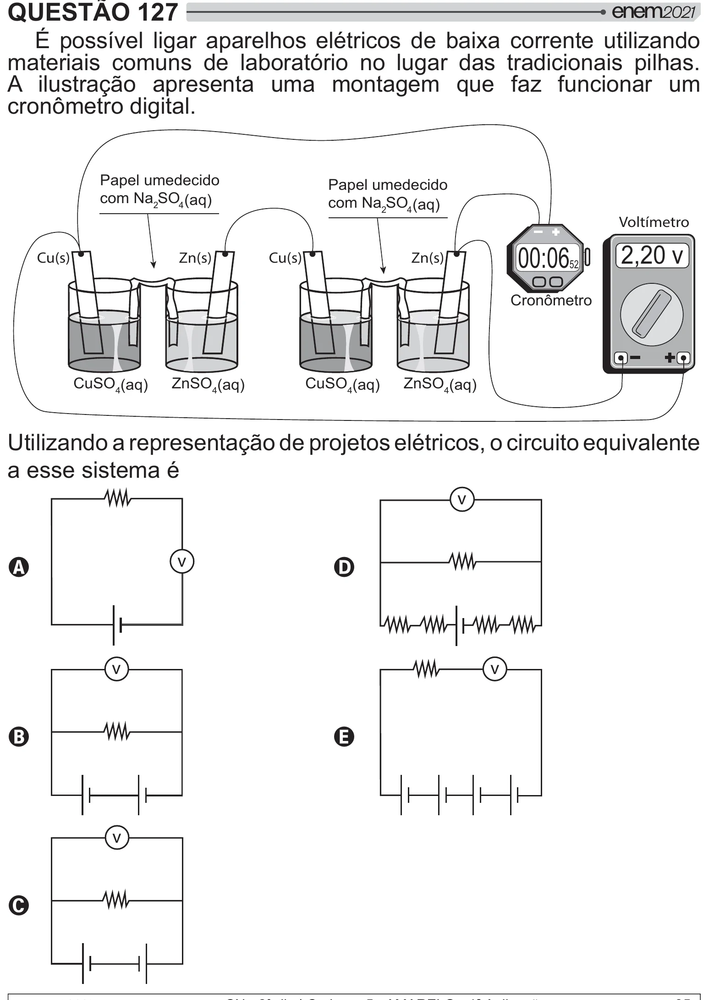

Texto extraído (pode conter ruído)

QUESTÃO 127  
É possível ligar aparelhos elétricos de baixa corrente utilizando  
materiais comuns de laboratório no lugar das tradicionais pilhas.  
A ilustração apresenta uma montagem que faz funcionar um  
2  !  
Papel umedecido  
Papel umedecido  
com Na 2 SO 4 (aq)  
com Na 2 SO 4 (aq)  
Voltímetro  
2,20 v  
Cu(s)  
Zn(s)  
Cu(s)  
Zn(s)  
00:06  
52  
Cronômetro  
CuSO 4 (aq)  
ZnSO 4 (aq)  
CuSO 4 (aq)  
ZnSO 4 (aq)  
Utilizando a representação de projetos elétricos, o circuito equivalente  
a esse sistema é  
v  
v  
A  
D  
v  
v  
B  
E  
v  
C

