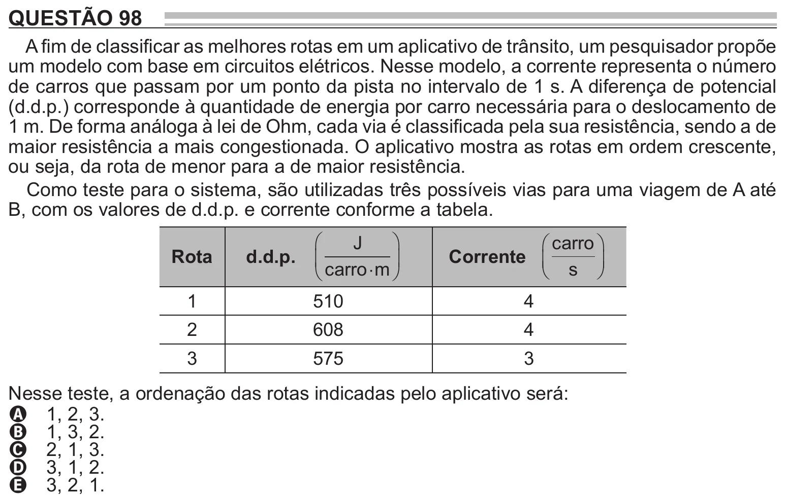

Texto extraído (pode conter ruído)

QUESTÃO 98  
A fim de classificar as melhores rotas em um aplicativo de trânsito, um pesquisador propõe  
um modelo com base em circuitos elétricos. Nesse modelo, a corrente representa o número  
de carros que passam por um ponto da pista no intervalo de 1 s. A diferença de potencial  
(d.d.p.) corresponde à quantidade de energia por carro necessária para o deslocamento de  
1 m. De forma análoga à lei de Ohm, cada via é classificada pela sua resistência, sendo a de  
maior resistência a mais congestionada. O aplicativo mostra as rotas em ordem crescente,  
ou seja, da rota de menor para a de maior resistência.  
Como teste para o sistema, são utilizadas três possíveis vias para uma viagem de A até  
B, com os valores de d.d.p. e corrente conforme a tabela.  
J  
 carro   
  
  
Rota  
d.d.p.  
Corrente   
  
  
  
carro  
  
m  
 s   
  
  
1  
510  
4  
2  
608  
4  
3  
575  
3  
Nesse teste, a ordenação das rotas indicadas pelo aplicativo será:  
A 1, 2, 3.  
B 1, 3, 2.  
C 2, 1, 3.  
D 3, 1, 2.  
E 3, 2, 1.

