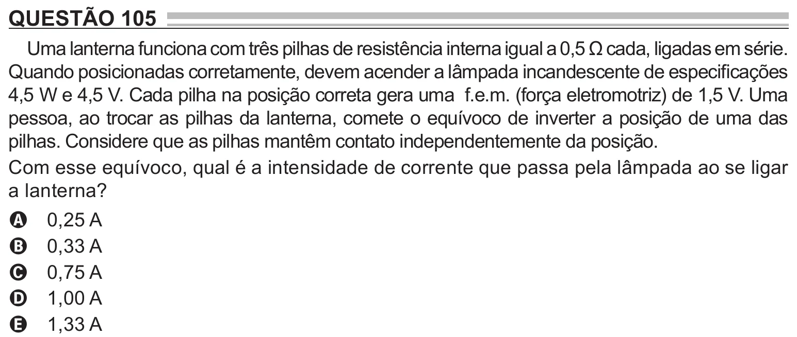

Texto extraído (pode conter ruído)

QUESTÃO 105  
Uma lanterna funciona com três pilhas de resistência interna igual a 0,5 Ω cada, ligadas em série.  
Quando posicionadas corretamente, devem acender a lâmpada incandescente de especificações  
4,5 W e 4,5 V. Cada pilha na posição correta gera uma f.e.m. (força eletromotriz) de 1,5 V. Uma  
pessoa, ao trocar as pilhas da lanterna, comete o equívoco de inverter a posição de uma das  
pilhas. Considere que as pilhas mantêm contato independentemente da posição.  
Com esse equívoco, qual é a intensidade de corrente que passa pela lâmpada ao se ligar  
a lanterna?  
0,25 A  
A  
0,33 A  
B  
0,75 A  
C  
1,00 A  
D  
1,33 A  
E

