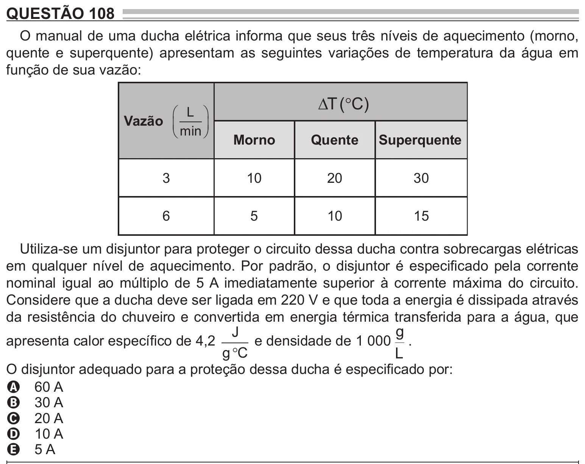

Texto extraído (pode conter ruído)

QUESTÃO 108  
O manual de uma ducha elétrica informa que seus três níveis de aquecimento (morno,  
quente e superquente) apresentam as seguintes variações de temperatura da água em  
função de sua vazão:  
T (  C )  
 L   
Vazão   
  
 min   
Morno  
Quente  
Superquente  
3  
10  
20  
30  
6  
5  
10  
15  
Utiliza-se um disjuntor para proteger o circuito dessa ducha contra sobrecargas elétricas  
em qualquer nível de aquecimento. Por padrão, o disjuntor é especificado pela corrente  
nominal igual ao múltiplo de 5 A imediatamente superior à corrente máxima do circuito.  
Considere que a ducha deve ser ligada em 220 V e que toda a energia é dissipada através  
da resistência do chuveiro e convertida em energia térmica transferida para a água, que  
J  
g  
apresenta calor específico de 4,2  
e densidade de 1 000 .  
g  C  
L  
O disjuntor adequado para a proteção dessa ducha é especificado por:  
A 60 A  
B 30 A  
C 20 A  
D 10 A  
E 5 A

