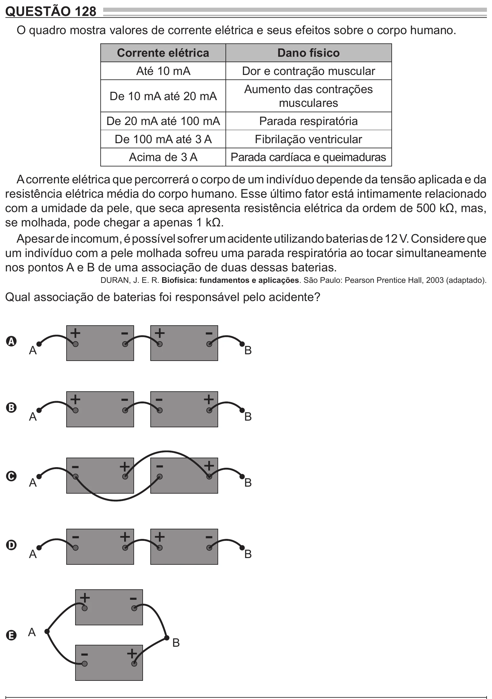

Texto extraído (pode conter ruído)

QUESTÃO 128  
O quadro mostra valores de corrente elétrica e seus efeitos sobre o corpo humano.  
Corrente elétrica  
Dano físico  
Até 10 mA  
Dor e contração muscular  
Aumento das contrações  
De 10 mA até 20 mA  
musculares  
De 20 mA até 100 mA  
Parada respiratória  
De 100 mA até 3 A  
Fibrilação ventricular  
Acima de 3 A  
Parada cardíaca e queimaduras  
A corrente elétrica que percorrerá o corpo de um indivíduo depende da tensão aplicada e da  
resistência elétrica média do corpo humano. Esse último fator está intimamente relacionado  
com a umidade da pele, que seca apresenta resistência elétrica da ordem de 500 kΩ, mas,  
se molhada, pode chegar a apenas 1 kΩ.  
Apesar de incomum, é possível sofrer um acidente utilizando baterias de 12 V. Considere que  
um indivíduo com a pele molhada sofreu uma parada respiratória ao tocar simultaneamente  
nos pontos A e B de uma associação de duas dessas baterias.  
DURAN, J. E. R. Biofísica: fundamentos e aplicações. São Paulo: Pearson Prentice Hall, 2003 (adaptado).  
Qual associação de baterias foi responsável pelo acidente?  
-  
-  
+  
+  
A  
A  
B  
-  
-  
+  
+  
B  
A  
B  
-  
-  
+  
+  
C  
A  
B  
-  
-  
+  
+  
D  
A  
B  
-  
+  
E A  
B  
-  
+

