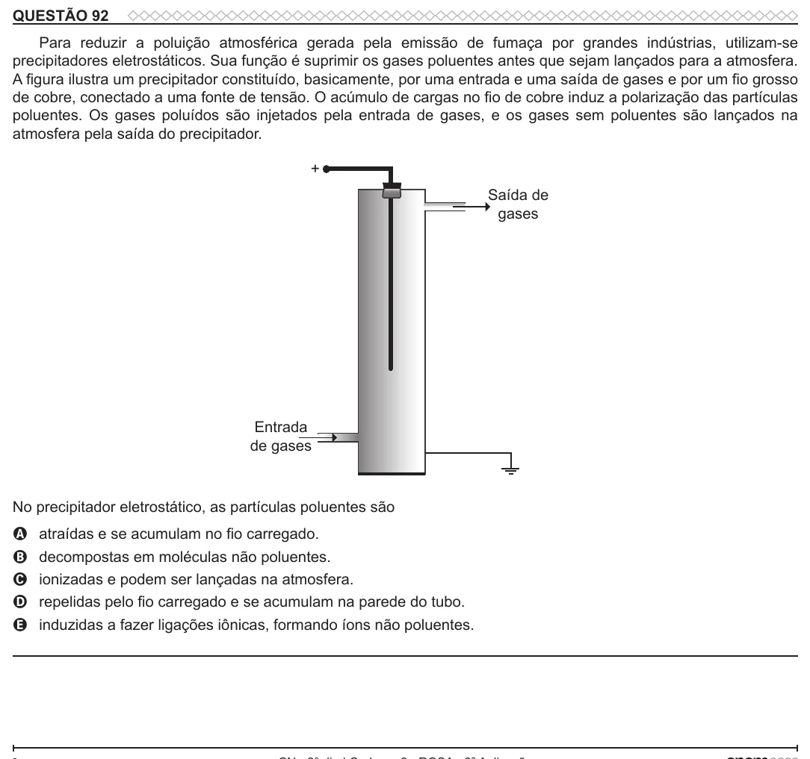

Texto extraído (pode conter ruído)

QUESTÃO 92  
Para reduzir a poluição atmosférica gerada pela emissão de fumaça por grandes indústrias, utilizam-se  
precipitadores eletrostáticos. Sua função é suprimir os gases poluentes antes que sejam lançados para a atmosfera.  
A figura ilustra um precipitador constituído, basicamente, por uma entrada e uma saída de gases e por um fio grosso  
de cobre, conectado a uma fonte de tensão. O acúmulo de cargas no fio de cobre induz a polarização das partículas  
poluentes. Os gases poluídos são injetados pela entrada de gases, e os gases sem poluentes são lançados na  
atmosfera pela saída do precipitador.  
+  
Saída de  
gases  
Entrada  
de gases  
No precipitador eletrostático, as partículas poluentes são  
atraídas e se acumulam no fio carregado.  
A  
decompostas em moléculas não poluentes.  
B  
ionizadas e podem ser lançadas na atmosfera.  
C  
repelidas pelo fio carregado e se acumulam na parede do tubo.  
D  
E  
induzidas a fazer ligações iônicas, formando íons não poluentes.

