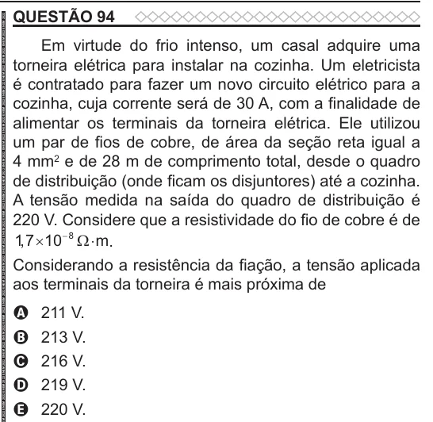

Texto extraído (pode conter ruído)

QUESTÃO 94  
Em virtude do frio intenso, um casal adquire uma  
torneira elétrica para instalar na cozinha. Um eletricista  
é contratado para fazer um novo circuito elétrico para a  
cozinha, cuja corrente será de 30 A, com a finalidade de  
alimentar os terminais da torneira elétrica. Ele utilizou  
um par de fios de cobre, de área da seção reta igual a  
4 mm 2 e de 28 m de comprimento total, desde o quadro  
de distribuição (onde ficam os disjuntores) até a cozinha.  
A tensão medida na saída do quadro de distribuição é  
220 V. Considere que a resistividade do fio de cobre é de  
1 , 7  10  8 m .  
Considerando a resistência da fiação, a tensão aplicada  
aos terminais da torneira é mais próxima de  
211 V.  
A  
213 V.  
B  
216 V.  
C  
219 V.  
D  
220 V.  
E

