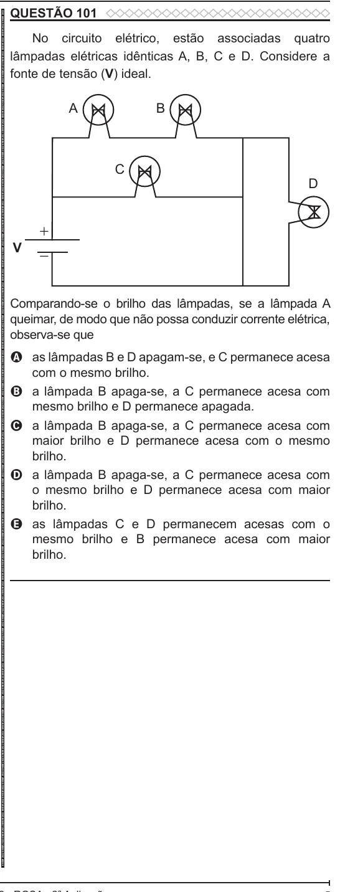

Texto extraído (pode conter ruído)

QUESTÃO 101  
ENEM 2022 ENEM 2022 ENEM 2022 ENEM 2022 ENEM 2022 ENEM 2022 ENEM 2022 ENEM 2022 ENEM 2022 ENEM 2022 ENEM 2022 ENEM 2022 ENEM 2022 ENEM 2022 ENEM 2022 ENEM 2022 ENEM 2022 ENEM 2022 ENEM 2022 ENEM 2022 ENEM 2022 ENEM 2022 ENEM 2022 ENEM 2022 ENEM 2022 ENEM 2022 ENEM 2022 ENEM 2022 ENEM 2022 ENEM 2022 ENEM 2022 ENEM 2022 ENEM 2022 ENEM 2022 ENEM 2022 ENEM 2022 ENEM 2022 ENEM 2022 ENEM 2022 ENEM 2022 ENEM 2022 ENEM 2022 ENEM 2022 ENEM 2022 ENEM 2022 ENEM 2022 ENEM 2022 ENEM 2022 ENEM 2022 ENEM 2022 ENEM 2022 ENEM 2022 ENEM 2022 ENEM 2022 ENEM 2022 ENEM 2022 ENEM 2022 ENEM 2022 ENEM 2022 ENEM 2022 ENEM 2022 ENEM 2022 ENEM 2022  
No circuito elétrico, estão associadas quatro  
lâmpadas elétricas idênticas A, B, C e D. Considere a  
fonte de tensão (V) ideal.  
A  
B  
C  
D  
+  
V  
−  
Comparando-se o brilho das lâmpadas, se a lâmpada A  
queimar, de modo que não possa conduzir corrente elétrica,  
observa-se que  
A as lâmpadas B e D apagam-se, e C permanece acesa  
com o mesmo brilho.  
B a lâmpada B apaga-se, a C permanece acesa com  
mesmo brilho e D permanece apagada.  
C a lâmpada B apaga-se, a C permanece acesa com  
maior brilho e D permanece acesa com o mesmo  
brilho.  
D a lâmpada B apaga-se, a C permanece acesa com  
o mesmo brilho e D permanece acesa com maior  
brilho.  
E as lâmpadas C e D permanecem acesas com o  
mesmo brilho e B permanece acesa com maior  
brilho.

