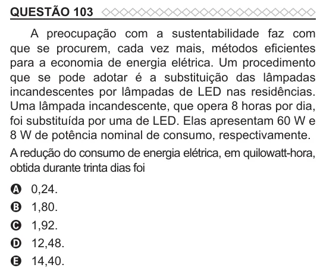

Texto extraído (pode conter ruído)

QUESTÃO 103  
A preocupação com a sustentabilidade faz com  
que se procurem, cada vez mais, métodos eficientes  
para a economia de energia elétrica. Um procedimento  
que se pode adotar é a substituição das lâmpadas  
incandescentes por lâmpadas de LED nas residências.  
Uma lâmpada incandescente, que opera 8 horas por dia,  
foi substituída por uma de LED. Elas apresentam 60 W e  
8 W de potência nominal de consumo, respectivamente.  
A redução do consumo de energia elétrica, em quilowatt-hora,  
obtida durante trinta dias foi  
0,24.  
A  
1,80.  
B  
1,92.  
C  
12,48.  
D  
14,40.  
E

