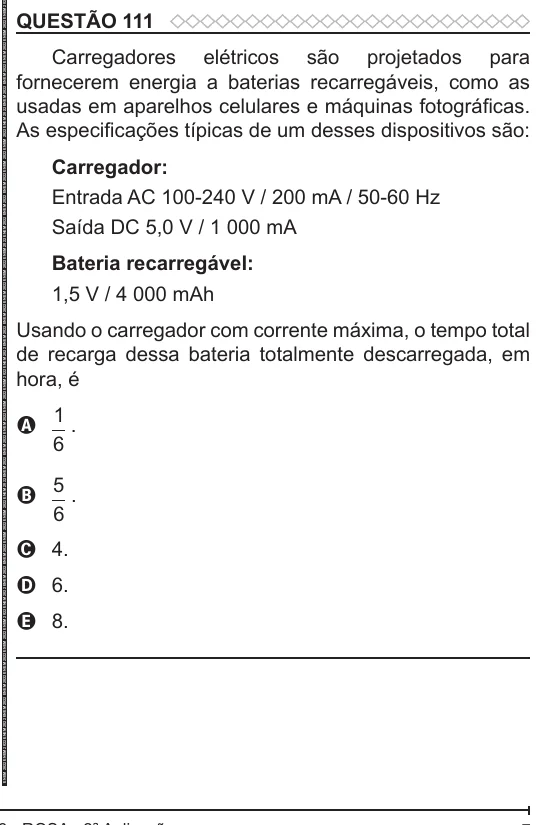

Texto extraído (pode conter ruído)

QUESTÃO 111  
Carregadores elétricos são projetados para  
fornecerem energia a baterias recarregáveis, como as  
usadas em aparelhos celulares e máquinas fotográficas.  
As especificações típicas de um desses dispositivos são:  
Carregador:  
Entrada AC 100-240 V / 200 mA / 50-60 Hz  
Saída DC 5,0 V / 1 000 mA  
Bateria recarregável:  
1,5 V / 4 000 mAh  
Usando o carregador com corrente máxima, o tempo total  
de recarga dessa bateria totalmente descarregada, em  
hora, é  
1  
.  
A  
6  
5  
B  
.  
6  
C 4.  
D 6.  
E 8.

